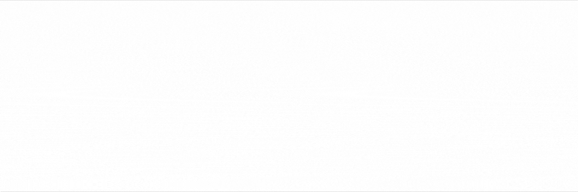
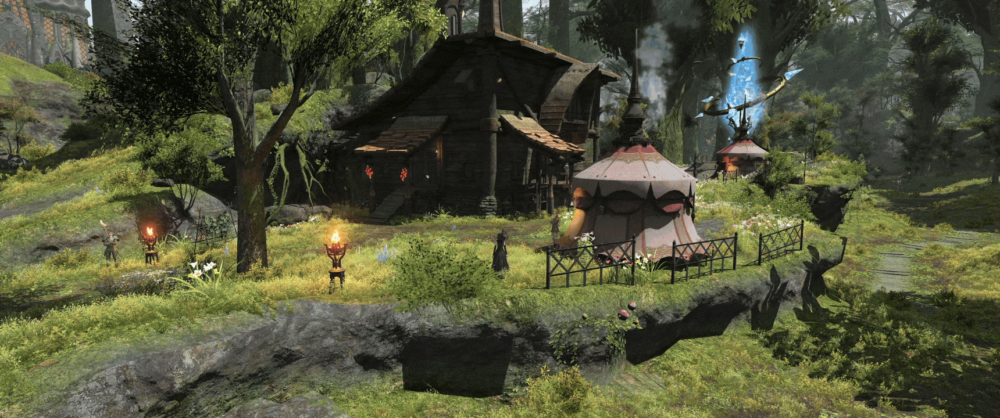
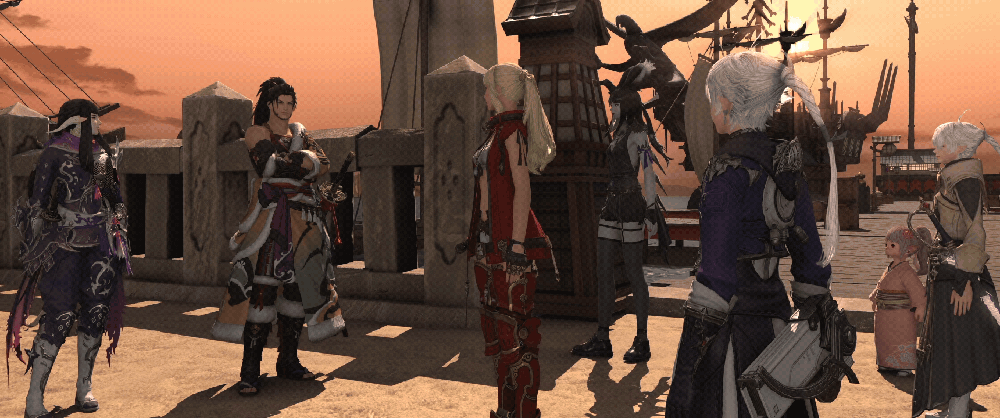
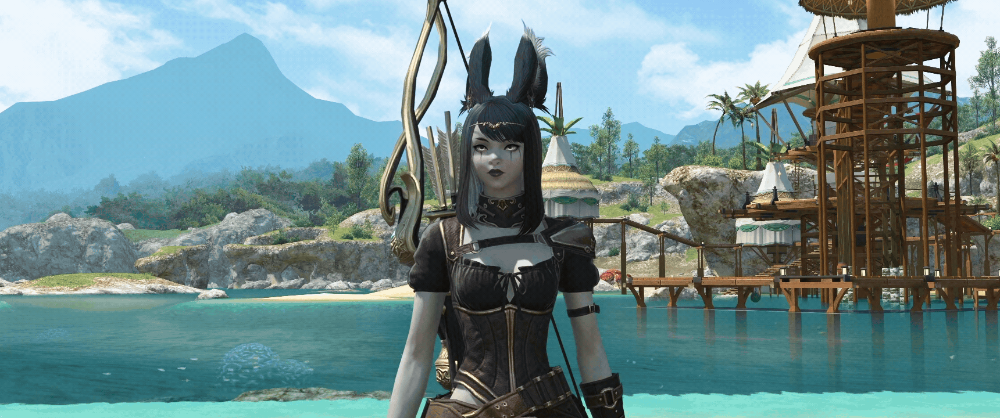
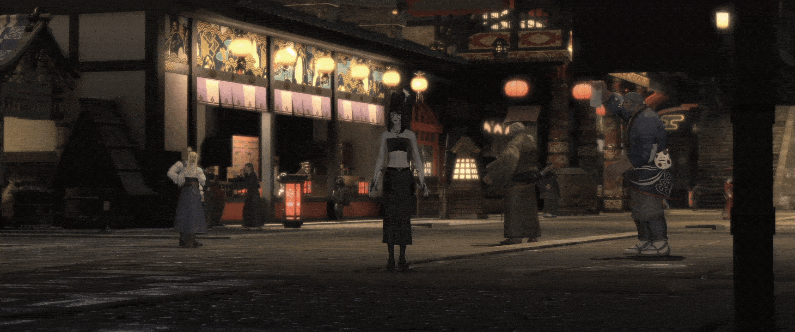
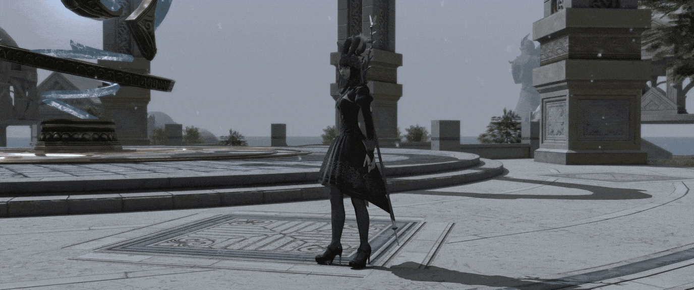
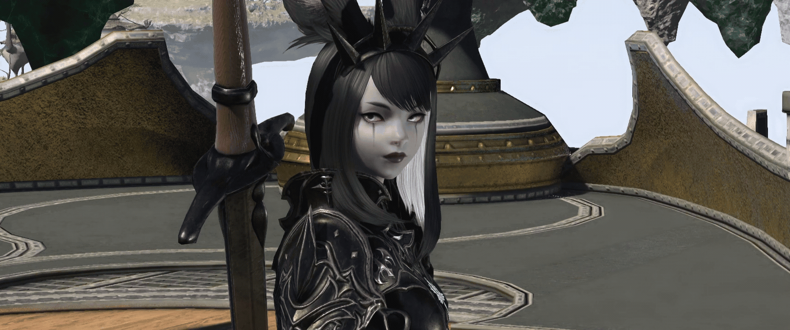
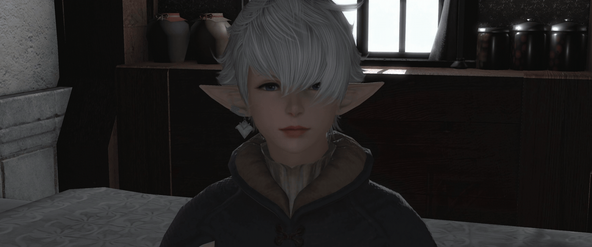

# Lightwarden

A graphics overhaul for Final Fantasy XIV. Unlike traditional ReShade shaders and presets, it doesn't just work on the final image. It replaces and extends parts of the game's own rendering pipeline to give it a more modern look, in the spirit of what ENB did for Skyrim, without replacing any of the game's textures or models.

Fair warning: it requires capable hardware. For perspective, I've targeted 30 fps on an RTX 4090 at 3440×1440 with DLAA. That being said, turning off/lowering features and using things like DLSS upscaling, you can win back a some performance.

**Status: in development.**

## Comparisons

Each GIF shows vanilla and Lightwarden. Lightwarden only: no post-processing or DLSS 5 NR.

## Key features

- **Lighting:** soft sun and lamp shadows that sharpen near contact (PCSS, contact shadows), ambient occlusion (visibility bitmask), bounce light (screen-space global illumination with probe-based lamp bounce), and lamps that actually light the rooms they're in (baked shadows for every lamp, light from glowing scenery)
- **Atmosphere:** volumetric fog and light shafts (froxel-based), ground mist that reacts, volumetric clouds, particle effects such as dirt, dust motes in the light, darker nights
- **Water:** hybrid planar and screen-space reflections, waves that follow the weather and wind, wakes, ripples and caustics
- **Characters:** skin with subsurface scattering (Burley diffusion) and light through thin parts like ears, eye shading, softer hair shadows, foot inverse kinematics, and lip sync: mouths that follow the actual voice lines in cutscenes, worked out from the audio with NVIDIA Audio2Face (English voices)
- **Weather:** its own falling snow, wet surfaces and puddles, snow on surfaces, wind through grass and trees
- **Camera:** a choice of tonemappers (AgX, GT7, an ACES fit, film LUTs) with auto exposure and HDR10 output, a physically based lens flare that follows the aperture, bloom, halation, diffusion, chromatic aberration, lens dirt, film grain and motion blur
- **Depth of field and autofocus:** a cinematic autofocus for cutscenes that finds every face in the shot, focuses on the speaker's eye, follows over-the-shoulder shots and the cutscene's own focus pulls, picks an aperture for each shot and racks focus smoothly at cuts. In GPose, click anywhere on the picture to focus there, and/or take a stacked depth-of-field still: accumulation DoF
- **A clean UI:** every effect is drawn before the game's interface, so the HUD, chat and nameplates stay sharp and untouched. No extra UI-masking add-on or shader is needed (such as REST or KeepUI).
- **Presets:** save, share and switch between complete looks

## How it works

Lightwarden has three parts. Each does a different job, and they talk to each other while the game runs.

### 1. The ReShade add-on: the engine

The add-on sits inside the game's drawing and watches every step of a frame as the game builds it. It recognises the game's own rendering passes, and then either swaps in Lightwarden's version or adds new passes of its own. The shadows, ambient occlusion, bounce light, fog, clouds, water, skin and falling snow are all drawn here, in the middle of the frame, with the same information the game itself has: depth, surface direction, materials and the scene's real light values. A bit further than a ReShade preset, which usually only work on the finished image.

### 2. The ReShade effects: the camera and film

These finish the picture the way a camera would: exposure and tonemapping, bloom, lens flare, depth of field, motion blur, colour grading, halation and grain. Lightwarden's tonemapper replaces the game's own, and the add-on runs several of these effects before it, on the scene's true brightness rather than on an already-flattened image. Bright things then bloom, flare and blur the way they would through a real lens.

### 3. The Dalamud plugin: the control panel and the eyes on the game

The plugin holds every setting for the other two parts, and the presets. It also reads what the game is doing (the camera, the weather, the time of day, the zone, where lights and characters are) and passes that along, so the lighting and atmosphere follow the game rather than guess from the picture. A few features live entirely in the plugin because they aren't rendering at all: lip sync, foot inverse kinematics, the autofocus, and scanning a zone's lamps and scenery so their light and shadows can be worked out ahead of time.

## Performance

As I've mentioned above, Lightwarden is a heavy graphics mod. It adds a lot of rendering work on top of the game, and it was built and tuned on an RTX 4090 at 3440×1440 with a goal of 30 fps (FFXIV is my GTA VI). Expect a real cost to your frame rate, more so in busy cities (yes, Limsa AFKers render at beautiful 25fps) and other heavy scenes.

Almost every feature is its own option, so you can choose what you pay for. Presets make that easier: a preset is one small file holding a complete setup, and Lightwarden ships with a default preset and a lighter one. Presets can be shared, so people with similar hardware can trade settings that suit it, and switching between them takes one click.

Also, there's everyone's favorite modern AAA feature, SHADER COMPILATION, that goes on during game startup and baking right after loading zones so expect some stutters or extended black screens here and there (should usually only be once per zone load but always at startup).

## Requirements

- Final Fantasy XIV on Windows, launched with XIVLauncher and Dalamud
- ReShade with full add-on support
- Optional, for HDR output and frame generation: OptiScaler

## Conflicts

- REST and KeepUI may conflict with what Lightwarden already does. Disable/delete them before installing
- BetterShadows conflicts with Lightwarden so disable/delete before installing.
- Penumbra mods that replace the game's shader files (some skin, hair and body mods) can stop Lightwarden's features working on what those shaders draw. Texture and model mods are fine.
- Other HDR or tonemap mods (such as RenoDX) replace the same part of the frame. Use one or the other.
- ReShade effects that do their own lighting from depth (GI, AO, bloom, DoF) will double up with Lightwarden's. Turn them off.
- No idea what's up with GShade nowadays; just stick to ReShade with full add-on support.

## Installation Instructions

**This assumes you have a clean install of FFXIV, please use your best judgement if you are installing on top of... whatever you have**
1. Install the game as usual
2. Install XIVLauncher
3. Install Reshade with full add-on support
4. Start the game and change these in-game settings:
5. Open Dalamud
6. Add this Repo
7. reserved
8. (Optional for HDR, DLAA, DLSS upscaling, DLSS-G, DLSS-NR): Install the Optiscaler fork

## Known limitations

Lightwarden works inside a game that wasn't built for any of this, with real-time techniques that each have their limits. The main ones:

- **Depth of field:** blurred backgrounds can show a faint halo or soft fringe around sharp subjects, most visibly round hair and at the edges of characters. This is the limit of any real-time depth of field that works from the picture; only ray-traced or path-traced depth of field avoids it. For GPose stills, the stacked depth of field gives true lens blur without it.
- **Bounce light is mostly screen-space:** light bounces off what's on screen. Bright surfaces just out of view or behind you don't light the scene, so bounce light can change a little as you turn the camera. Lamps use their own baked bounce, which doesn't have this problem.
- **Reflections:** screen-space reflections can only show what's on screen. Large water uses a true mirror reflection, but things the game doesn't draw (off-screen, or hidden behind other things) can still be missing and flicker; Lightwarden does its best to fill those gaps from remembered scenery, screen-space reflections and the sky.
- **Spell effects** are flat glowing images to the game, not lights. They light their surroundings, but they don't cast proper shadows or shafts through the fog.
- **Materials:** the game doesn't say what a surface is made of, so looks tied to a material (velvet, lacquer, brushed metal and so on) are limited.
- **Lip sync** covers English voice lines in cutscenes, and only lines that have been baked. Creatures and other non-human faces keep the game's own mouth movement.
- **Rooms inside bigger zones:** inn rooms and other indoor zones switch off the outdoor fog and mist, but a room that's part of a larger outdoor zone may still show some.
- **Game patches** can break parts of Lightwarden until it's updated.
- **Hardware:** developed and tested only on an nVidia RTX 4090. All other cards, nVidia or otherwise are untested.

## References

Lightwarden's code is its own, but it stands on published work. The main ones:

- **Tonemapping and colour:** AgX (Troy Sobotka; Blender 4's version); the Gran Turismo 7 tonemapper (Polyphony Digital, 2025); Oklab (Ottosson, 2020)
- **Soft shadows:** Percentage-Closer Soft Shadows (Fernando, 2005)
- **Ambient occlusion:** Screen Space Indirect Lighting with Visibility Bitmask (Therrien et al., 2023); Practical Real-Time Strategies for Accurate Indirect Occlusion, or GTAO (Jimenez et al., 2016); Material Advances in Call of Duty: WWII, for occlusion of direct light (Chan, 2018)
- **Bounce light:** Dynamic Diffuse Global Illumination (Majercik et al., 2019); Scaling Probe-Based Real-Time Dynamic Global Illumination for Production (Majercik et al., 2021); ReSTIR (Bitterli et al., 2020); SVGF (Schied et al., 2017)
- **Lamps:** Real Shading in Unreal Engine 4, for area-light highlights (Karis, 2013)
- **Clouds:** The Real-Time Volumetric Cloudscapes of Horizon Zero Dawn (Schneider, 2015)
- **Moving mist:** Stable Fluids (Stam, 1999)
- **Water:** Simulating Ocean Water (Tessendorf, 2001), with the JONSWAP wave spectrum (Hasselmann et al., 1973)
- **Skin:** Burley's normalized diffusion for subsurface scattering (Burley, 2015); the dual-lobe skin highlight as used in Unreal Engine
- **Lens flare:** Physically-Based Real-Time Lens Flare Rendering (Hullin et al., 2011); Practical Real-Time Lens-Flare Rendering (Lee and Eisemann, 2013)
- **Motion blur:** A Fast and Stable Feature-Aware Motion Blur Filter (Guertin et al., 2014); Next Generation Post Processing in Call of Duty: Advanced Warfare (Jimenez, 2014)
- **Lip sync:** nVidia Audio2Face

## Acknowledgements

- **Boris Vorontsov**, creator of ENBSeries, which I've used across GTA, Skyrim, Fallout and more, for showing the world what's possible.
- **l00ping**, for Natural and Atmospheric Tamriel (NAT and NAT.ENB).
- **NovaKDalton and JawZ**, for Relighting Skyrim.
- **[SirenBrink](https://github.com/SirenBrink)** (a.k.a. Nickle), whose DLSS and OptiScaler work for FFXIV inspired me and got me to finish this project, and whose FFXIV-NativeDoF showed how to read the game's depth of field.
- **The creators of Octane Render and Blender**, for starting me on this journey by making fast, GPU-accelerated rendering available to everyone.
- **Marty McFly**, for constantly pushing the boundaries of screen-space ReShade techniques.
- **Alexander Sannikov**, for his enthusiasm and knowledge.
- **Thomas Harle** (tharlevfx), for his YouTube videos.
- **[Daniel Ilett](https://www.youtube.com/@danielilett)**, for his YouTube videos.
- **Elliott McSherry** (EMC3D), for his YouTube videos.
- **[David O'Reilly](https://www.davidoreillygameart.com/)** (Game World Art), for his YouTube videos.

## Licenses

Lightwarden includes or is based on the following third-party work. Their licence notices are in the [licenses](licenses) folder and ship with every release:

- **ReShade's add-on headers** (Patrick Mours): BSD 3-Clause. [Notice](licenses/THIRD-PARTY-LICENSE-ReShade.md)
- **The Gran Turismo 7 tonemapper**, after Polyphony Digital's reference code (2025): MIT. [Notice](licenses/THIRD-PARTY-LICENSE-GT7.txt)
- **FAST noise textures** (EA SEED, Electronic Arts): BSD 3-Clause. [Notice](licenses/THIRD-PARTY-LICENSE-FastNoise.txt)
- **FFXIV-NativeDoF** (SirenBrink), whose memory layout Lightwarden uses to read the game's depth of field: MIT. [Notice](licenses/THIRD-PARTY-LICENSE-NativeDoF.txt)

## AI disclosure

Lightwarden's code was written with the help of AI (Anthropic's Claude). The look, the design decisions, the testing and every judgement about what stays and what goes are mine. No AI-generated art is used anywhere.

The one feature built on a machine-learning model is lip sync: nVidia Audio2Face works out mouth movement from the game's voice lines ahead of time, and Lightwarden plays it back on the game's existing faces' bones. It doesn't create any images.

## Disclaimer

Lightwarden is a hobby project, originally made for personal use so is shared as is. There'll be limited if any support, and bug reports and requests may not get an answer.
Lightwarden is an unofficial, fan-made project. It is not affiliated with or endorsed by Square Enix. Third-party tools are against the game's terms of service; use it at your own risk. It changes only how the game looks on your own screen.
